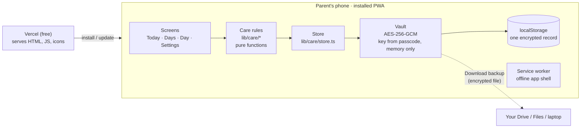

# Architecture

LittleSteps is a single-user, on-device app. There is no backend.

## Decisions

| Decision | Why | Trade-off |
|---|---|---|
| **Static export, no server** | Parent-only use, so nothing needs sharing. No server means no database to run, patch, back up or breach, and RM 0 a month. Same as the Finance Tracker. | One device. No babysitter input or live viewing elsewhere. |
| **Records encrypted in the phone's storage** | Child records never leave the phone. Vercel serves only code. | Losing the phone or clearing site data loses records since the last backup. Mitigated by encrypted backups and a weekly reminder. |
| **Reuse the Finance Tracker's vault, auto-lock, PWA and headers** | Proven code with tests, one toolchain for both apps. | Inherits its limits (for example, unlocking takes a moment because the key is derived from the passcode with 600,000 PBKDF2 rounds). |
| **Rules as pure functions** (`(data, input, now) → Result`) | Every rule is unit-tested with a fixed clock, including midnight and timezone cases. UI code never changes data directly. | None significant. |
| **One JSON document, versioned, gzip + AES-GCM** | A diary is small: a busy year is about 0.26 MB once compressed and encrypted (measured by `tests/unit/size.test.ts`), against roughly 5 MB of browser storage. Whole-document encryption is simple and atomic. | Not suited to photos or very large data. Photos were left out by decision. |
| **Kuala Lumpur time, fixed UTC+8** | Malaysia has had no daylight saving since 1982, so a KL clock time maps to exactly one instant. Tested against the platform's own `Asia/Kuala_Lumpur` rules. | If Malaysia ever changes its offset, `lib/care/time.ts` needs updating. |

## Module map

| Path | Responsibility |
|---|---|
| `src/lib/care/types.ts` | Data model and conventions |
| `src/lib/care/attendance.ts` | Drop-off, pickup, corrections, missed visits, removal, today's status, late/early flags |
| `src/lib/care/entries.ts` | Meals, naps, activities, health, medicine, incidents, notes; nap durations |
| `src/lib/care/report.ts` | Daily report and month overview (computed, never stored) |
| `src/lib/care/setup.ts` | Child, people, usual times, medicine instructions, settings |
| `src/lib/care/schema.ts` | Shape checks and version upgrades for stored and restored data |
| `src/lib/care/export.ts` | CSV export with spreadsheet-formula guarding |
| `src/lib/care/time.ts` | Kuala Lumpur dates and times, formatting |
| `src/lib/care/history.ts` | Change-history lines and ids |
| `src/lib/care/store.ts` | Applies a rule to the unlocked data and saves on success |
| `src/lib/security/*` | Passcode vault, encryption, backup files, auto-lock |
| `src/components/*` | Screens and sheets |

## Data flow for one tap

1. The parent taps **Dropped off**, picks who did it, and taps **Save drop-off**.
2. `apply((d) => dropOff(d, input, new Date()))` runs the rule against the decrypted data held in memory.
3. If the rule fails, the sheet shows its message and nothing is saved.
4. If it succeeds, the new data replaces the in-memory copy and a write is queued. The vault seals it with AES-GCM (fresh IV) and writes the single record to `localStorage`.
5. Screens re-render from the store.

## Offline

`public/sw.js` uses network-first with a cache fallback for same-origin GET requests, so the installed app opens without internet. Pages contain no records (those are only in encrypted storage), so caching them is safe.
