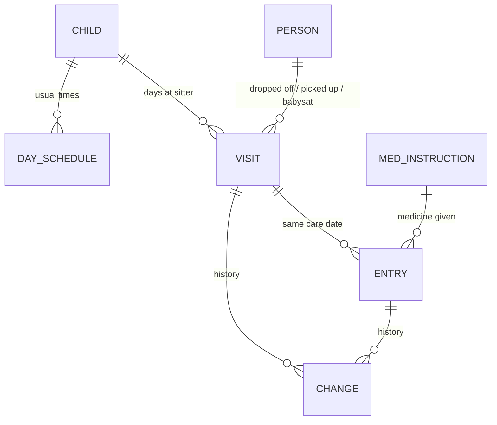

# Data model

Defined in `src/lib/care/types.ts`. All records live in one `CareData` document, encrypted by the vault.

| Record | Fields | Notes |
|---|---|---|
| **Child** | name, birthDate? | One child |
| **Person** | id, name, role (`family` / `babysitter`), archived? | Names only. Never deleted, only hidden, because history refers to them |
| **DaySchedule** | weekday (0 = Sun), dropOff?, pickUp? | Usual times, for late/early flags |
| **Visit** | id, careDate, droppedOffAt, droppedOffBy, babysitterId, pickedUpAt?, pickedUpBy?, expected {dropOff?, pickUp?}, voided?, createdAt, updatedAt | `expected` copies the usual times at drop-off so later schedule edits don't rewrite history |
| **Entry** | id, careDate, at, type, detail?, voided?, createdAt, updatedAt, plus type fields below | One timeline item |
| — meal | meal (breakfast/lunch/dinner/snack/milk), food?, amount (all/most/half/little/none), ml? | `ml` only for milk |
| — nap | end? | No `end` = still asleep. Duration is calculated |
| — activity | kind (play/outdoor/learning/reading/other) | |
| — health | condition (well/unsettled/unwell), temperatureTenths? | 375 = 37.5 °C |
| — medication | instructionId, dose | Must reference an active instruction |
| — incident | severity (minor/attention/serious), detail, actionTaken? | |
| — note | detail | |
| **MedInstruction** | id, medicine, dose, when, notes?, active, createdAt | Medicine you authorise |
| **Change** | id, at, target (visit/entry), targetId, careDate, action (create/update/void), field?, from?, to?, reason? | Append-only history |
| **Settings** | graceMinutes (15), backupReminderDays (7), lastBackupAt? | |

## Conventions

- **Instants** are ISO 8601 UTC strings. **Care dates** are Kuala Lumpur dates `YYYY-MM-DD`. **Clock times** are KL `HH:mm`.
- **Integers for quantities:** millilitres, tenths of a degree, whole minutes.
- **Care date of a visit** = KL date of drop-off. **Care date of an entry** = the care date of the visit it falls inside, otherwise its own KL date. A snack at 00:30 during an evening visit belongs to the evening's day.
- **No hard deletes.** Removing a visit or entry sets `voided { at, reason }`. Reports and totals skip voided records; the change history keeps them.
- **Version:** `DATA_VERSION = 1`. When the shape changes, bump it and add a step to `MIGRATIONS` in `schema.ts`, so older backups still restore. Data from a newer version is refused, never half-read.

## Integrity rules (enforced in `attendance.ts` and `entries.ts`, covered by tests)

| Rule | Message shown |
|---|---|
| One open visit at a time | “She's already dropped off (since 8:12 AM). Record the pickup first.” |
| Pickup needs an open visit | “There's no drop-off to close. Record the drop-off first.” |
| Pickup after drop-off | “Pickup must be after drop-off (8:12 AM).” |
| No future times (2-minute allowance) | “The drop-off time is in the future.” |
| No overlapping visits | “That overlaps the visit on …” |
| Visit ≤ 24 hours | “That's more than 24 hours after drop-off. Check the date.” |
| Corrections and removals need a reason (≥ 3 characters) | “Add a short reason for the correction.” |
| Naps don't overlap, one running nap, ≤ 12 hours | “That overlaps another nap.” |
| Medicine only against an active instruction | “… is no longer authorised. Turn it back on in Settings first.” |
| Temperature 34.0–43.0 °C, milk 1–2000 ml, notes ≤ 500 characters | Field-specific messages |

An open visit from an earlier day, or one open for more than 16 hours, puts Today into **Needs a correction**.
